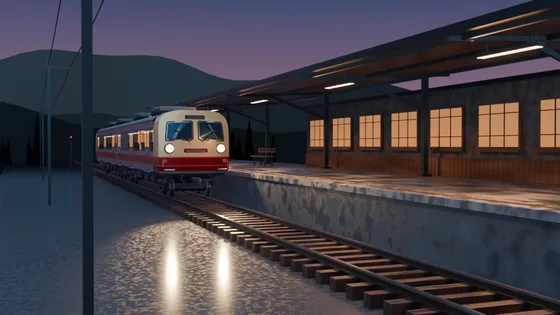
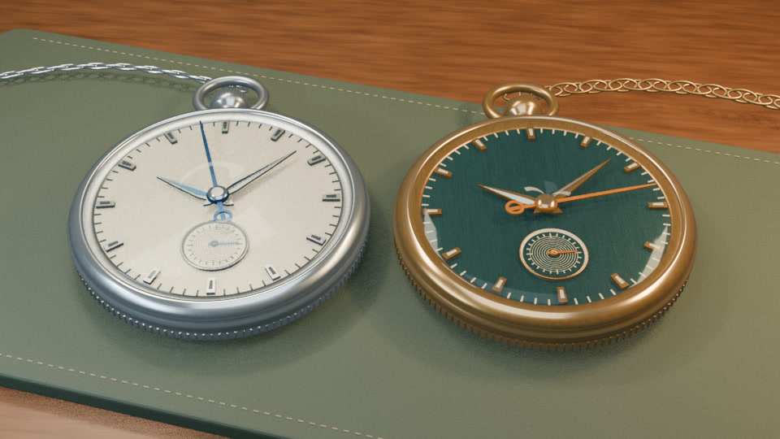
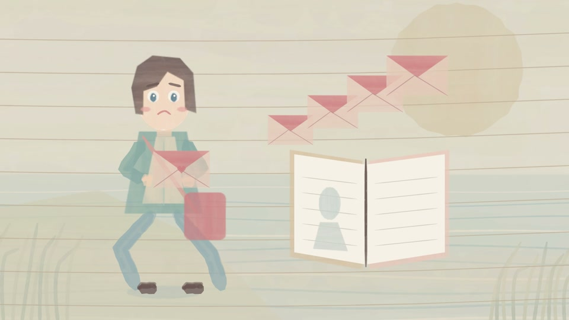

# Music to MV · 给喜欢的歌拍一支 MV

把一首歌交给 Skill，先听原唱、校歌词，再一起决定这支 MV 怎么拍。默认用 Blender 建场景、布光、设机位，叙事与歌词视觉都能从歌曲开始。最后拿到带原声的 MP4、字幕，以及能逐镜修改的工程。想把递出的外套换成一封信，或者让副歌的一次切镜晚半拍，都可以在工程里改。

### Blender 原生三维样片

| 叙事型 ·《雨后末班车》 | 歌词视觉 ·《两种时间》 |
| --- | --- |
|  |  |
| 两节电车沿轨道驶过站台。车灯照亮钢轨，镜头从车头转到车窗，最后落在留下的红外套上。 | 在 Blender 里建立表壳、无字刻度与指针。让指针从同一刻度出发，再用不同速度表现词义。 |
| [编辑电车、车站和三台摄影机](examples/blender-station/rain-station.blend) | [编辑表盘、材质和动画](examples/blender-clocks/clocks.blend) |

安装 Blender 后，可以直接打开工程改机位，也能用一条渲染命令让两种拍法对齐自己的歌。[用 Blender 拍一段音乐](references/blender.md)

### 摄影与图形样片

| 叙事型 MV ·《雨站》摄影版 | 歌词视觉 MV ·《两种时间》 |
| --- | --- |
|  |  |
| 站台上他拿着红外套，车窗再掠过时衣服已在她怀里。车体沿轨道驶近，站台保持原位。 | 每一句选一个看得见的动作。两根指针走向不同的刻度，观众便能看到“不同步”。 |
| [打开摄影底板、车体遮片与镜头表](examples/rain-cinema/) | [打开分层 SVG 和镜头表](examples/out-of-time/) |

上面是本 Skill 渲染的无声动图。两份公开工程都可以配仓库内程序生成的原创练习曲重新导出有声 MP4。

## 让它拍成你喜欢的样子

**叙事型 MV** 用人物和行动讲整段歌的情绪。**歌词视觉 MV** 用物件、空间和变化解释每句歌词。你可以自由选其中一种，再选材质。需要车辆沿轨道行驶、同一空间内切换机位、控制遮挡和灯光时，可以选 Blender。摄影关键帧适合从人脸、布料、湿地反光等现成画面出发制作镜头。也可以选像素、孔版印刷、水彩笔刷、剪纸、低多边形 3D 或动态歌词。两种类型的成片都只显示当句原歌词。歌词解读写进分镜，前奏和间奏用画面来讲。

材质之外还可以指定画面怎么变。“运动一点”可以拍成跟着跑者侧移，在鼓点上切弯道；“商务一点、又有点痴情”可以拍一个人在玻璃门关上后反复折起一张旧工牌；“冷静到疯狂”可以让主歌保持远景，到副歌才推近、加快切镜。角色、布景、色板、镜头运动和时长都能分别修改。[查看创作示例与镜头字段](references/direction.md)

### 之前做过的三支 MV

| 《富士山下》· 像素 | 《去年夏天》· 孔版印刷 | 《去年夏天》· 水彩笔刷 |
| --- | --- | --- |
|  |  |  |

这三张静帧来自作者此前制作的 MV。同一首《去年夏天》保留了两种材质，方便比较笔触和用色。[作品说明](gallery/README.md)

## 安装

Blender 三维制作使用 Blender 4.5 LTS，支持后台渲染。

准备 Node.js 20 或更高版本、Python 3.10 或更高版本，以及命令行可用的 FFmpeg 和 ffprobe。渲染中文字幕需要中文字体，常见选择有苹方、微软雅黑和思源黑体。

在 macOS / Linux 的终端或 Windows Git Bash 中，把整个仓库装进 Codex 的个人技能目录。下面使用 `~/.agents/skills`，已使用 `~/.codex/skills` 管理技能的环境也可以沿用自己的目录。

```sh
mkdir -p ~/.agents/skills
git clone https://github.com/FDU-liwenjie/music-to-mv.git ~/.agents/skills/music-to-mv
cd ~/.agents/skills/music-to-mv
npm ci
```

也可以用 GitHub 的 **Code → Download ZIP**，解压后把包含 `SKILL.md`、`render/` 和 `tools/` 的整层目录命名为 `music-to-mv`，放进技能目录，在里面运行 `npm ci`。

**只有音频、希望自动识别歌词时**，另装本地识别器。首次识别会下载模型。提供 LRC、SRT 或逐行 TXT 时可直接导入。以下是在 macOS / Linux 上创建识别环境的命令，Windows 可用 `.venv\Scripts\python.exe` 运行同样的 Python 命令。

```sh
python3 -m venv .venv
.venv/bin/python -m pip install -r requirements-asr.txt
```

在新的 Codex 对话里附上歌曲或给出本地文件路径，然后说：

> 用 $music-to-mv 给这首歌拍一支 Blender MV。先让我逐句核对歌词，再给我看副歌的两种拍法：一个故事、一个能读懂词义的三维镜头。我想要克制的动作和有冷暖变化的灯光。先做有原唱的小样，保留 .blend 给我改。

## 一次实际制作会经历什么

1. **确认歌词。** Skill 展示带时间的歌词草稿。你可以说“第 7 行最后一个字改成……”，单独试听这一行，或贴入自己查到的歌词。文本和时间均可修正。认可后保存 SRT。
2. **确定画面。** 比较同一段歌词的两种拍法，选材质、人物和情感变化。分镜会记录每镜开始和结束的秒数，以及谁在做什么。
3. **先看小样。** 用原声渲染 8–15 秒，集中看一个关键动作、一次转场和字幕。说“镜头多停半拍”就能局部重做。确认后可沿同一工程制作全曲。
4. **保留工程。** project.json 保存歌词、镜头与重音，JPG、PNG 或 SVG 保存摄影与绘画素材。MP4、SRT 和素材可以一起交付。[歌词及重音工具命令](tools/README.md)

### 先用 12 秒原创练习曲跑一遍

从仓库根目录运行。第一条命令用 Python 合成练习用的音轨，第二条用 Blender 导出 12 秒列车叙事，第三条用同一首练习曲的片段导出双表特写。

```sh
python3 examples/night-train/make_audio.py
node render/cli.mjs examples/blender-station/project.json outputs/rail.mp4 --width 960 --height 540 --fps 24
node render/cli.mjs examples/blender-clocks/project.json outputs/clocks.mp4 --width 960 --height 540 --fps 24
```

想对照同一段故事的不同美术，可以打开 [《雨站》剪纸工程](examples/rain-station/)。想从内置图形开始，可以打开 [《末班渡船》的两份基础镜头表](examples/night-train/)。也可以把输出名换成 PNG，再加 `--start 6.5`，只导出第 6.5 秒那一帧。给自己的歌曲建工程可运行：

```sh
python3 scripts/new_project.py "/path/to/song.mp3" "/path/to/my-mv" --mode narrative --style blender --blend "/path/to/scene.blend"
```

## 底层如何出片

Blender 模式启动本机的 Blender，读取 .blend 里的三维场景、渲染摄影机和动画。按歌曲时间抽取原生帧，再由公共合成步骤叠上当句歌词、接入原声。车辆和摄影机可各自动画，光照、反射和遮挡直接来自场景。

Python 和可选的 **faster-whisper** 在本地读取音轨，维护逐行歌词、试听片段和校订时间。另一条分析流程用低频能量的突变标记适合动作的重音候选。切镜可以跟鼓点，字幕可以等原唱开口，两套时间可以分别编辑。

Node.js 按原音轨上的时间逐帧读分镜。摄影模式使用本地 JPG / PNG 底板，分别控制取景中心、近景遮挡、主体运动和细雨。公开《雨站》的摄影关键帧由 AI 生成，列车与固定站台通过独立图层合成，切镜与原声都由代码控制。**Skia Canvas** 绘制像素、套印网点、水彩叠色、纸层和字体；每镜可以叠加独立 SVG / PNG，对单层设置位移、缩放和旋转。**Three.js** 用几何体、三维变换和透视相机构建低多边形布景，再把面片投影到画布。**FFmpeg** 将画面与输入歌曲裁到同一段，编码为 H.264 / AAC 的 MP4。Linux 缺中文字体时可设置环境变量 `MV_FONT` 指向本地中文字体文件。

制作流程借鉴 Anything2Explainer 的逐镜编排、抽帧复核与可编辑交付。当前仓库自带 MV 渲染器；此前两支《去年夏天》的美术实践还参考了 Lemo-Opuscar。[Anything2Explainer](https://github.com/Vincentwei1021/anything2explainer) · [Lemo-Opuscar](https://github.com/lemomo-ai/lemo-opuscar) · [Three.js](https://threejs.org/) · [faster-whisper](https://github.com/SYSTRAN/faster-whisper) · [FFmpeg](https://ffmpeg.org/)
