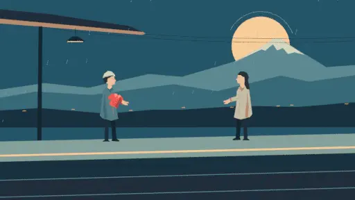
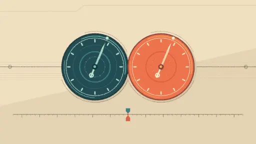
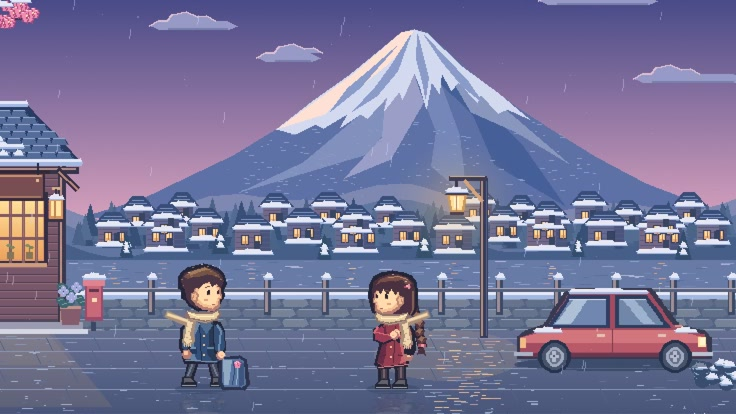
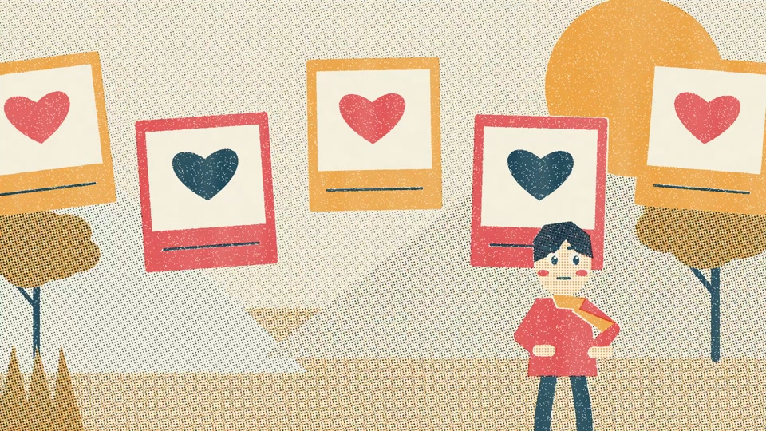

# Music to MV

Make a motion-graphics music video from your own recording. Start by listening and correcting the lyrics. Then choose what a phrase should look like, watch a short cut with the original audio, and revise the timing or the artwork. The deliverables include a video, an editable motion score and a native Blender scene.

| Narrative MV · The Red Coat | Lyric visual · Phase Difference |
| --- | --- |
|  |  |
| Two passengers meet on a platform. The camera moves in until both hands touch the coat. When the train clears the frame, only one passenger remains. [Open the example](examples/mg-rain-station/) | Watch two clock hands start together and fall out of step. The camera keeps both dials visible so you can see exactly when their rhythms separate. [Open the example](examples/mg-out-of-time/) |

The public previews loop silently. Both example projects can render with the bundled original instrumental. Personal productions use the recording and lyric language you supply.

## Make a video with the skill

Attach an audio file in a new Codex chat and invoke `$music-to-mv`. Try this prompt.

> Use $music-to-mv with this song. Show me the timed lyrics first. For the chorus, pitch both a small story and a direct visual reading of the same line. I want the verse to feel composed and the chorus to feel obsessive. Let me watch a short cut with the original recording before we make the full video.

1. **Review the song.** Import LRC or SRT, paste text you found, or run local transcription. Listen to any numbered line and correct its words or times. The instrumental passages stay free of text.
2. **Choose the reading.** A narrative MV follows a person or an object through a change. A lyric visual gives the line a visible subject and action. Either can be romantic, sad, restrained or energetic.
3. **Shape the motion.** Choose a surface and then describe the behavior. A restrained verse might hold one shape in a large area of empty space. An obsessive chorus might repeat the same gesture three times, each time a little further out of register. Rhythm, color, framing and material are separate decisions. [Direction guide](references/direction.md)
4. **Review a short cut.** Listen for the exact moment the action lands. A chorus entrance can trigger an impact while the lyric still waits for the singer's first word. After approval, extend the score and export the MP4, SRT, motion score and Blender scene.

## Install

Install Blender 4.5 LTS, Node.js 20 or newer, Python 3.10 or newer and FFmpeg with ffprobe. Use a font that covers the lyrics. Run the following commands in a terminal.

```sh
mkdir -p ~/.agents/skills
git clone https://github.com/FDU-liwenjie/music-to-mv.git ~/.agents/skills/music-to-mv
cd ~/.agents/skills/music-to-mv
npm ci
```

If you already keep personal skills under `~/.codex/skills`, use that directory instead. A GitHub ZIP download also works. Rename the extracted folder containing `SKILL.md` to `music-to-mv`, place it in the skills directory, and run `npm ci` inside it. Set `BLENDER_BIN` to the executable path for a custom Blender installation.

Optional local transcription uses faster-whisper. In a Python virtual environment, run `python -m pip install -r requirements-asr.txt` and use that interpreter to run `tools/lyrics.py transcribe`. The first model download requires internet access. You can also provide your own timed lyrics. [Lyrics, corrections and audio accents](tools/README.md)

## Try a scene

Run these commands from the repository root. The first synthesizes the original practice recording. The second exports one frame. The last two render the narrative and lyric-visual examples.

```sh
python3 examples/night-train/make_audio.py
node render/cli.mjs examples/mg-rain-station/project.json outputs/station.png --start 3
node render/cli.mjs examples/mg-rain-station/project.json outputs/station.mp4 --width 960 --height 540 --fps 24
node render/cli.mjs examples/mg-out-of-time/project.json outputs/out-of-time.mp4 --width 960 --height 540 --fps 24
```

## Start from your recording

```sh
python3 scripts/new_project.py "/path/to/song.wav" "/path/to/my-mv" --mode narrative
```

Choose `--mode lyric-visual` for direct interpretation. The new project includes a starter motion score and an editable Blender scene. The starter finds low-frequency accents in the recording and uses nearby ones to time changes of movement. Once you have the reviewed lyrics, replace the starter shapes with the subjects of the song. Rebuild the scene and render a preview.

```sh
python3 scripts/build_mg.py "/path/to/my-mv/motion.json" --output "/path/to/my-mv/scene.blend"
node render/cli.mjs "/path/to/my-mv/project.json" "/path/to/my-mv/preview.mp4" --start 0 --duration 4
```

**Edit timing in seconds.** `motion.json` holds cues, paths, colors, layer order, camera framing and animation keys. Blender evaluates the curves, fills and moving shapes. `project.json` points to the original recording and stores shot ranges and timed lyrics. FFmpeg encodes the picture and sound. After updating a lyric in the project, render the video again. After changing a shape in the score, rebuild the Blender scene first. You can also edit the .blend directly and render from it. Save hand-edited variants under a new filename before rebuilding from the score. [Motion score reference](scripts/MOTION.md) · [Native Blender workflow](references/blender.md)

## Earlier work

| *Under Mount Fuji* · Pixel art | *Last Summer* · Risograph | *Last Summer* · Watercolor |
| --- | --- | --- |
|  |  |  |

The last two stills use the same song. Compare the hard edges of the print with the translucent brushwork in the watercolor. The gallery also includes editable photographic, paper-cut and three-dimensional studies. [Gallery and credits](gallery/README.md)

The shot-by-shot editing and review process draws on [Anything2Explainer](https://github.com/Vincentwei1021/anything2explainer). The earlier print and watercolor studies also drew on [Lemo-Opuscar](https://github.com/lemomo-ai/lemo-opuscar).
